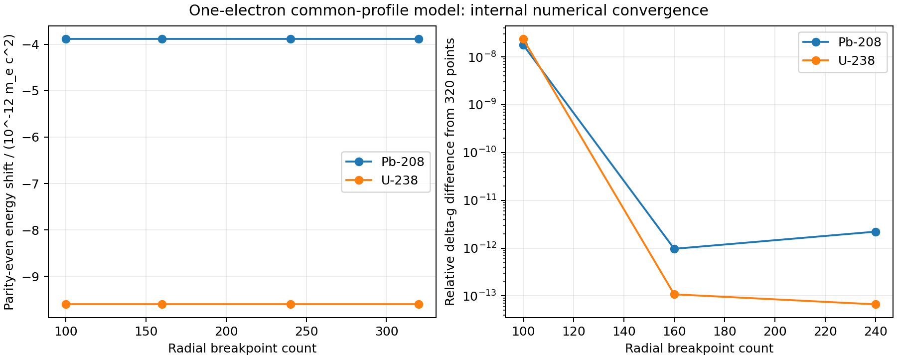

# Weak interactions in highly charged ions and heavy atoms

Master’s-thesis research by **Hrishikesh Sriman-Narayan**, Heidelberg University / Max Planck Institute for Nuclear Physics, supervised by **Zoltan Harman** (2025).

This project studies weak electron–nucleus interactions using relativistic atomic wavefunctions. The current runnable companion solves a finite-nucleus radial Dirac problem in a B-spline dual-kinetic-balance basis, evaluates parity-even weak energy shifts and parity-odd matrix elements, and cross-checks the weak magnetic-response correction through an independent electron-mass derivative.



## Run the current version

The [reproducible companion](reproducible/README.md) is the maintained entry point. It uses the corrected local spherical implementation, documented after the thesis, rather than the retained historical binaries. It contains all required project/SLATEC sources; system BLAS/LAPACK and compilers are installed separately or provided by Docker.

```bash
git clone https://github.com/Hrishikesh57/Master-Thesis-Weak_Int.git
cd Master-Thesis-Weak_Int/reproducible
python3.14 -m venv .venv
source .venv/bin/activate
python -m pip install -r requirements-lock.txt
python workspace/programs/weak_spherical/build.py
OPENBLAS_NUM_THREADS=1 python -m unittest discover \
  -s workspace/programs/weak_spherical -p 'test_spherical.py' -v
OPENBLAS_NUM_THREADS=1 python scripts/reproduce.py --output results/demo --validate
```

For the native route, install `gfortran`, `gcc`, `binutils`, BLAS/LAPACK development libraries, and matching Python development headers first. The [full setup guide](reproducible/README.md#run-locally-on-linux) includes prerequisites and output descriptions.

The container route installs those build dependencies and runs the tests during the image build:

```bash
docker build -t weak-ion-study ./reproducible
mkdir -p results
docker run --rm --user "$(id -u):$(id -g)" \
  -v "$PWD/results:/output" weak-ion-study \
  --output /output/demo --validate
```

Run those Docker commands from the repository root. Volume syntax is for Linux/macOS shells; on SELinux systems add `:Z` to the mount if needed. The image was built and exercised with rootless Podman; native Docker Engine was unavailable during local verification.

## Results and verification

The recorded baseline passes **10 physics tests** and **58 numerical comparisons across 16 Pb-208/U-238 calculations**, including variations in radial resolution, spline order, quadrature and cavity size. [Reference data](reproducible/results/reference/validation.json), [the validation record](reproducible/docs/validation.md), and [the numerical model](reproducible/docs/spherical-model.md) explain the parameters and scope. The source build also works when the checkout path contains spaces.

The common charge/proton/neutron profiles are explicit numerical assumptions. Internal convergence does not provide a precision APV uncertainty budget. The 1s–2s parity-violating amplitude is a Dirac-only diagnostic; Lamb shifts, widths and measurement geometry are outside that model. The bound-electron magnetic-correction manuscript remains unpublished.

## Code and provenance

The maintained calculation is in [`reproducible/workspace/programs/weak_spherical/`](reproducible/workspace/programs/weak_spherical/). [`scripts/reproduce.py`](reproducible/scripts/reproduce.py) runs the example and optional convergence study. The [operator-correction record](reproducible/docs/operator-correction-record.md) documents post-thesis corrections, and [source attribution](reproducible/THIRD_PARTY.md) distinguishes the inherited solver, SLATEC, and project interfaces.

The root `workspace/`, `workspace_f2py/`, `Reading/`, and older files are preserved as the historical research record. They are not the current quick-start route and may depend on old inputs, paths or binary interfaces. This update does not overwrite the submitted thesis, rewrite history, or claim that every historical result has been revalidated. Later unrelated research directions and private manuscript material are excluded from the companion.
