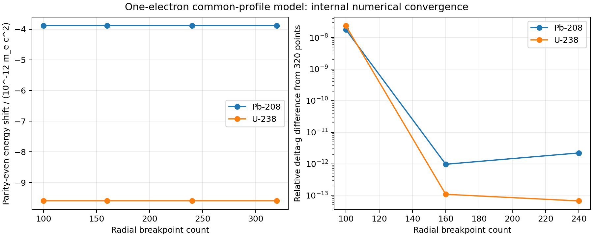

# Weak interactions in relativistic one-electron ions

A source-buildable computational companion to **Weak Interaction Effects in Highly Charged Ions and Heavy Atoms**, the 2025 master’s thesis of Hrishikesh Sriman-Narayan, Heidelberg University / MPIK, supervised by Zoltan Harman.

The release solves a finite-nucleus radial Dirac problem using the inherited Fortran B-spline dual-kinetic-balance (DKB) solver. A Python interface computes parity-even weak energy shifts, parity-odd matrix elements, and the weak correction to the bound-electron magnetic response. It checks that response independently using an electron-mass derivative. The runnable baseline includes corrections and a replacement source-built wrapper developed after the thesis; it is not a claim to regenerate every original thesis table.



## Run locally on Linux

Download the GitHub ZIP and extract it, or use a normal checkout. Open a terminal in the repository root. The validated Python environment uses Python 3.14. A Fortran compiler, C compiler, Python development headers, `nm`, and BLAS/LAPACK development libraries are required.

On Ubuntu/Debian, install the native build prerequisites (use a Python 3.14 installation with matching headers):

```bash
sudo apt-get update
sudo apt-get install gfortran gcc binutils liblapack-dev libblas-dev
python3.14 -m venv .venv
source .venv/bin/activate
python -m pip install -r requirements-lock.txt
python workspace/programs/weak_spherical/build.py
OPENBLAS_NUM_THREADS=1 python -m unittest discover \
  -s workspace/programs/weak_spherical -p 'test_spherical.py' -v
OPENBLAS_NUM_THREADS=1 python scripts/reproduce.py --output results/demo --validate
```

A standard Ubuntu installation may require installing Python 3.14 and its development/venv packages separately. The Docker route below provides a complete userspace. Native macOS and Windows builds have not been tested.

The builder compiles all project and SLATEC objects from the included source; it does not link retained research `.o` or `.so` files. `build_manifest.json` records source and extension hashes, compiler flags and version, and exact commands. The loader rejects modified source or an extension that does not match its manifest. Rebuild after source, Python, or NumPy changes. Checkout paths containing spaces are supported by the release build wrapper.

## Run with Docker

```bash
docker build -t relativistic-weak-interactions .
mkdir -p results
docker run --rm --user "$(id -u):$(id -g)" \
  -v "$PWD/results:/output" relativistic-weak-interactions \
  --output /output/docker-demo --validate
```

The image installs the native build dependencies, compiles the extension from source, and runs its ten tests during the build. These volume commands use a Linux/macOS shell; add `:Z` to the mount on SELinux systems if needed. The image uses an unprivileged user by default.

The normal example calculates the explicitly modelled Pb-208 input. `--validate` additionally runs sixteen Pb-208/U-238 calculations and writes `validation.json` and `convergence.png`. Output directories and scientific JSON files must be fresh. The reference example is stored in [`results/reference/pb208.json`](results/reference/pb208.json); its input profile differs from the rms-defined convergence cases, so their numbers must not be compared as identical inputs.

## Numerical evidence

[The validation report](docs/validation.md) records the actual run. Ten tests exercise normalization, orthogonality, nuclear charge, potential evaluation, weak Hermiticity, selection rules, phases, point-Coulomb limits, and two independent magnetic-response methods. The convergence driver evaluates radial breakpoint counts 100/160/240/320 and varies spline order, quadrature and cavity size. Its 58 comparisons pass for the documented common-profile models; this establishes internal numerical checks, not a precision uncertainty budget.

At 160 breakpoints, order 9, 20 quadrature points and cavity radius 2.5 reference bohr:

| Common-profile model | Parity-even shift / $m_e c^2$ | Weak magnetic correction $\delta g$ |
|---|---:|---:|
| Pb-208, rms radius 5.5012 fm | $-3.8884884\times10^{-12}$ | $-1.3328870\times10^{-11}$ |
| U-238, rms radius 5.8571 fm | $-9.5998305\times10^{-12}$ | $-3.1233279\times10^{-11}$ |

Here electric charge, point-proton and point-neutron profiles are explicitly assumed equal. They are numerical test models, not measured independent nuclear densities. The units, sign conventions, mass differentiation and negative-energy contributions are explained in [the model report](docs/spherical-model.md).

## Code and documentation

- [`spherical.py`](workspace/programs/weak_spherical/spherical.py): nuclear input objects, normalized Fermi profiles, DKB basis access, weak operators, magnetic response and mass derivative.
- [`kernel.f90`](workspace/programs/weak_spherical/kernel.f90): narrow interface to the reused radial solver.
- [`build.py`](workspace/programs/weak_spherical/build.py): source-only build and provenance manifest.
- [`test_spherical.py`](workspace/programs/weak_spherical/test_spherical.py) and [`validate.py`](workspace/programs/weak_spherical/validate.py): physical checks and numerical-control scans.
- [September correction record](docs/operator-correction-record.md): changes to the earlier weak-operator implementation and the distinction from the legacy wrapper.
- [Source provenance and attribution](THIRD_PARTY.md): reused BspQed and SLATEC components.

## Limits

The baseline is spherical, one-electron, and tree level. It omits recoil, electron correlation, nuclear polarization/deformation, and radiative matching. Its working weak-potential sign convention is documented; signed Standard Model matching remains unresolved in the underlying source record. The included Dirac-only 1s–2s parity-violating amplitude is a diagnostic with no Lamb-shift/width or experimental-geometry model. It must not be presented as a precision APV prediction. Later photon, quadrupole, scattering, and molecular studies are outside this release. The bound-electron $g$ manuscript remains unpublished.
